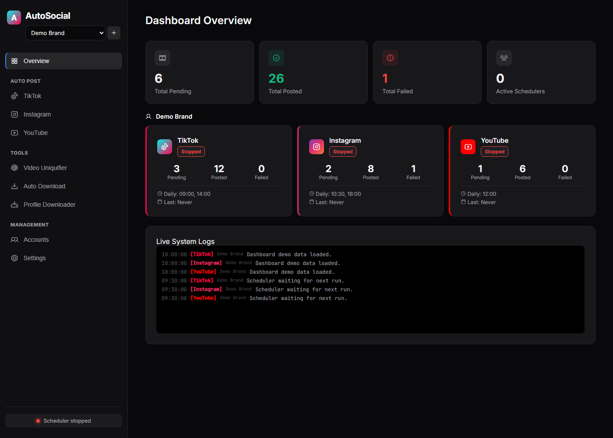

# AutoSocial Studio

For permanent server deployment, runtime-data migration, cost estimates and rollback, see [Cloud migration](docs/CLOUD-MIGRATION.md). The existing Cloudflare relay to a workstation is not permanent compute.

[](https://github.com/tlrus/AutoSocial/actions/workflows/ci.yml)
[](LICENSE)
[](package.json)

AutoSocial Studio is a local, multi-account automation dashboard for short-form
video and photo workflows across TikTok, Instagram, YouTube, Telegram, and X. It combines a local
Express dashboard, Playwright-powered upload flows, per-account queues,
schedulers, yt-dlp downloader utilities, and an FFmpeg-based video uniquifier.

The dashboard supports local operation and persistent Linux server deployment.
Remote access requires dashboard password authentication. Hosting and external
API credentials must be configured separately.



## Why This Exists

AI coding tools make it easier than ever for indie builders to ship products.
Distribution is still the hard part. AutoSocial Studio helps builders turn
launch clips, demos, product updates, and short-form experiments into a
repeatable local marketing workflow without handing account sessions to a
hosted service.

The goal is not mass posting or engagement spam. The goal is a practical
creator operations dashboard: organize accounts, prepare queues, schedule
posts, reuse captions, download reference material, and process videos from one
local control plane.

## Who It Helps

- Indie hackers launching multiple products.
- AI builders who need a repeatable content workflow after shipping with AI
  coding tools.
- Small teams that want local browser sessions instead of a hosted service
  storing account credentials.
- Maintainers and contributors experimenting with responsible automation around
  product updates, demos, and community content.

## Features

- Install the HTTPS dashboard as an app on a phone or Mac. The default My Socials view connects Instagram, TikTok, YouTube, X, and a configured Telegram bot using official APIs, with saved profiles, available statistics, import progress, and explicit refresh. Follow [Web app deployment](docs/WEB_APP_DEPLOYMENT.md) to configure hosting and provider credentials.
- Social access tokens are encrypted on the persistent data volume and are never sent to the browser. API coverage depends on provider permissions and plans; Telegram reads pending bot updates, not full channel history. Offline mode shows a connection screen and does not cache private account data.
- Browse saved calendar posts and queue media across all accounts in the Account Data view (`#account-data`), with search, filters, and JSON/CSV exports. This catalog uses local AutoSocial data; browser cookies, tokens, and private settings are excluded.
- Manage multiple brands/accounts with isolated queues and browser sessions.
- Use the First-Run Setup page to verify local dependencies, login sessions,
  and queue folders.
- Post queued videos to TikTok, Instagram, and YouTube.
- Schedule video and photo posts in the calendar; photos target Instagram,
  Telegram, and X.
- Create drafts with 17 selectable agent roles using a local Ollama model;
  see [Agent posts](docs/AGENT-POSTS.md). OpenAI API integration is not configured.
- Persist Playwright login sessions under `.profiles/<account>/<platform>`.
- Schedule posts with cron expressions, daily times, or instant-post mode.
- Download recent TikTok videos with yt-dlp and fan them out into queues.
- Scan/download TikTok profiles into `autodownload/profile_downloads`.
- Run FFmpeg-based video uniquification from the dashboard or CLI, with an
  optional user-provided logo overlay.

## Requirements

- Node.js 20.9+ (Node.js 24 recommended)
- npm
- Playwright Chromium
- FFmpeg and ffprobe in `PATH`
- Optional: `yt-dlp.exe` in `autodownload/` for downloader features

Windows is the primary target for the bundled `yt-dlp.exe` workflow, but the
dashboard and core Node services are ordinary Node.js.

## Quick Start

```bash
npm ci
npx playwright install chromium
npm run doctor
```

Create your local environment file:

```powershell
Copy-Item .env.example .env
```

Start the dashboard:

```bash
npm run dashboard
```

Open http://127.0.0.1:3000.

The default `My Socials` view shows official API connections. Use `Setup` for browser-based publishing: it checks local dependencies and shows the exact
pending folders where videos should be dropped for each platform.

## Configuration

Copy `.env.example` to `.env` and review the values that matter for your
workflow.

Common settings:

- `CRON_EXPRESSION`, `INSTAGRAM_CRON_EXPRESSION`, `YOUTUBE_CRON_EXPRESSION`
- `TZ`, `BROWSER_LOCALE`
- `HEADLESS`
- `POST_DELAY_MS`, `POST_PUBLISH_HOLD_MS`, `FAILURE_HOLD_MS`
- `AUTO_ADD_SOUND`, `DEFAULT_SOUND_QUERY`
- `RANDOM_QUEUE_ORDER`
- `DEFAULT_CAPTION`
- `UNIQUIFY_LOGO_IMAGE`
- `WATCH_CHANNEL`, `WATCH_INTERVAL`, `WATCH_MAX_VIDEOS`, `WATCH_MIN_VIEWS`
- `AUTO_POST_PLATFORMS`
- `DASHBOARD_HOST`, `DASHBOARD_PORT`

Hashtag captions in `.env` should be quoted:

```env
DEFAULT_CAPTION="#mybrand #shorts"
```

The sample config ships without a default caption, watch channel, logo, or
sound query. Set those in `.env` or in the dashboard for your own workflow.

## Dashboard Security

The dashboard binds to `127.0.0.1` by default. Run `npm run setup:password`
to configure password authentication; the password is stored as a salted hash
in the private environment file.

Mutating dashboard requests include a same-origin guard so random websites
cannot blindly trigger local dashboard actions through the browser.

Binding to a non-local address requires both `DASHBOARD_ALLOW_REMOTE=true`
and a valid `DASHBOARD_PASSWORD_HASH`. Use HTTPS for remote access and keep
secrets and browser profiles outside the public source repository.

See [SECURITY.md](SECURITY.md) for more details.

## First-Time Login

Open the dashboard, go to `Accounts`, and start a login session for each
platform you want to use. Sessions are stored on disk and reused between runs.

The CLI `login` command is still TikTok-specific:

```bash
npm run login
```

## Queue Layout

Queues are account-aware:

```text
queue/<account>/tiktok/pending
queue/<account>/instagram/pending
queue/<account>/youtube/pending
```

Successful uploads move into `posted`; failed uploads move into `failed`.

Supported video extensions:

- `.mp4`
- `.mov`
- `.webm`
- `.avi`
- `.mkv`

Caption sidecars can use the same base filename:

- `.description`
- `.txt`

## Commands

```bash
npm run dashboard
npm run clean:debug
npm run doctor
npm run check
npm run login
npm run post
npm run daemon
npm run uniquify
npm run video-info -- --video "C:\path\video.mp4"
npm run autodownload
```

Notes:

- The dashboard is the preferred workflow.
- `clean:debug` removes local debug screenshots and dashboard logs only.
- `login`, `post`, and `daemon` are TikTok CLI flows.
- Instagram and YouTube posting are managed through the dashboard.
- `uniquify` and `video-info` require FFmpeg and ffprobe.
- `autodownload` requires yt-dlp.

## Development

Run the local checks:

```bash
npm run check
npm audit --omit=dev
```

The test suite focuses on local logic that does not require live social
platform access: queue handling, sidecars, filesystem archiving, scheduler time
logic, and config parsing.

## Runtime Data

Do not commit local runtime data. The `.gitignore` covers known generated paths,
including:

- `.env`
- `.profiles/`
- `.scheduler-state/`
- `*-state.json`
- `queue/`
- `downloads/`
- `user-assets/`
- `autodownload/downloads/`
- `autodownload/profile_downloads/`
- `autodownload/info.json`
- `last-*.png`

Before publishing a fork, inspect `git status --short` and `git status
--ignored`.

## Responsible Use

Users are responsible for complying with platform terms, account policies, rate
limits, local law, and content rights. This project does not grant permission to
post content you do not own or have permission to use.

Prefer official platform APIs where they are available for your workflow. Avoid
spam, deceptive behavior, unauthorized scraping, and posting without consent.
Keep sessions local, rotate credentials if they are exposed, and review
platform limits before enabling scheduled automation.

## Roadmap

See [ROADMAP.md](ROADMAP.md) for planned work around safer automation controls,
official API integrations, creator workflow templates, and maintainer tooling.

## License

MIT. See [LICENSE](LICENSE).
